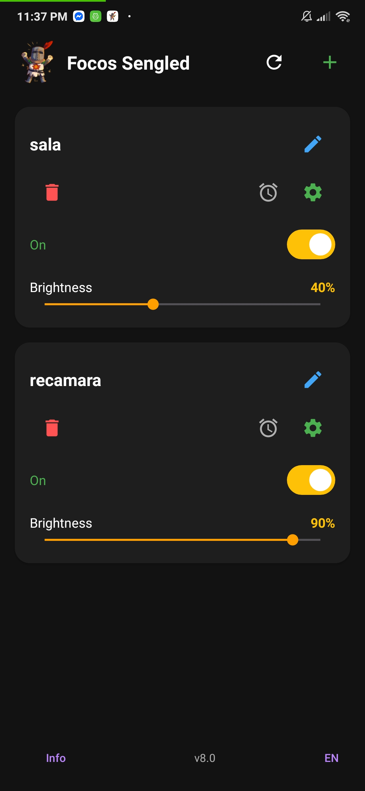
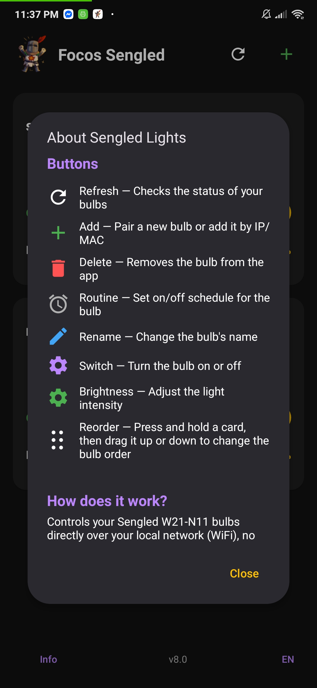

# Sengled Control — Local Sengled Bulb Control

**Sengled smart bulbs, under your own roof. No cloud. No accounts. No Internet required.**



When Sengled discontinued these bulbs, their cloud died — and with it, the official app. This project reverse-engineers the local Sengled UDP protocol and gives you a native Android app that talks directly to each **Sengled W21-N11** white bulb (EMW3091 module, fixed 2700K) over your LAN (UDP port 9080). Discontinued hardware, kept alive — 100% local, 100% yours.

## What's in this repo

| Folder | What it is |
|---|---|
| `SengledApp/` | **Android app** (Kotlin, Material 3) that controls your bulbs from your phone |

> **SengledTools** (Python tooling, web panel, pairing wizard, Home Assistant integration, protocol docs) lives in its **own repository** — it is a fork of the community project [`HamzaETTH/SengledTools`](https://github.com/HamzaETTH/SengledTools). The local clone is kept out of this repo (see `.gitignore`) so each repository keeps its own history and upstream.

## SengledApp — Android app

Native app (minSdk 24, targetSdk 34) that talks directly to each bulb over UDP.

### What you can do

| Action | What it does |
|---|---|
| **Refresh** | Check the live status of every bulb on your LAN: *Prendida* (on) / *Apagada* (off) / *Sin conexión* (offline) |
| **Add / pair a bulb** | Pair a new bulb with the in-app wizard (Wi-Fi credentials + built-in MQTT broker), or add an already-connected bulb by IP/MAC |
| **Turn on / off** | Tap the switch on any bulb card to power the bulb |
| **Adjust brightness** | Drag the slider (1–100%) to set the light intensity |
| **Schedule routines** | Set daily on/off times per bulb, each with its own brightness (e.g. ON at 19:30 at 7%, OFF at 00:00) |
| **Rename** | Give each bulb a friendly, recognizable name |
| **Reorder cards** | Press and hold a card and drag it up or down to change the bulb order |
| **Delete** | Remove a bulb from the app (it stays configured in your router) |

The app also works hands-free in the background: it re-applies missed routine events when the phone reconnects to home Wi-Fi (catch-up), keeps bulbs connected through a persistent local MQTT broker, and surfaces network-change notifications and diagnostics in the toolbar.



### Build

```powershell
cd SengledApp
$env:JAVA_HOME = "C:\Program Files\Eclipse Adoptium\jdk-17.x"
.\gradlew.bat assembleDebug --no-daemon
```

On Linux/macOS use `./gradlew assembleDebug`. Requires Java 17 (AGP 8.5.2). APKs land in `SengledApp/app/build/outputs/apk/debug/`.

### Network requirements

- Phone must be on the **same LAN** as the bulbs (UDP port 9080).
- **Static IP per bulb** is recommended (reserve them in your router's DHCP) so routines keep working after router restarts.
- Bulb IPs and MACs live in the app's private storage (SharedPreferences file `sengled_bulbs`, keys `bulbs_json` and `mac_<id>`), not in the source. Edit them in-app from each bulb card; `BulbRegistry.kt` only defines the read/write API.

## SengledTools — Python tooling (separate repo)

The Python tooling lives in the local `SengledTools/` folder, which is a fork of the community project [`HamzaETTH/SengledTools`](https://github.com/HamzaETTH/SengledTools):

- `sengled_tool.py` — CLI to control/diagnose bulbs, Wi-Fi pairing wizard
- `sengled-web.py` — local web panel with one card per bulb
- `sengled/wifi_setup.py` — full provisioning flow (connect to the bulb's AP, scan networks, send encrypted credentials)
- `custom_components/sengled_udp/` — Home Assistant integration over local UDP
- `docs/` — reverse-engineered protocol references: UDP, MQTT, Wi-Fi pairing

The `sengled-pair.ps1` and `start-sengled-web.bat` helper scripts at the root require that local fork (including its `.venv`).

## Known issues / limitations

### Bulb identity matching uses the first 5 MAC bytes (sibling-bulb caveat)

**Symptom.** After pairing, a bulb could be saved with the wrong MAC (and therefore
the wrong id/name), or discover itself as a different bulb. The MAC looks *almost*
right — it differs from the real one by a single byte at the end.

**Why it happens.** These bulbs expose **two different identities**:

| Identity | Example | Where it comes from |
|---|---|---|
| AP BSSID | `80:A0:36:B1:93:**74**` | The bulb's soft-AP interface, read while the phone is connected to the bulb's setup Wi-Fi |
| LAN MAC | `80:A0:36:B1:93:**73**` | The bulb's real network interface, reported by `search_devices` on your home LAN |

They are the **same device**, two interfaces, and they can differ in the **last byte**.
The pairing handshake response carries no MAC, so the app falls back to the BSSID — which
is *not* the bulb's LAN MAC.

The app already handles this: `WifiDetector.findBulbByMac` matches a bulb by its
**first 5 bytes** (OUI + device prefix) instead of the full 12-hex MAC, and the pairing
wizard then adopts the real LAN MAC reported by `search_devices` before saving.

**The residual risk.** Matching on only 5 bytes means two **sibling bulbs** that share the
same 5-byte prefix and differ **only in the last byte** could be confused — the app might
select the wrong one, or match a device that is not the intended bulb. This does not
happen with the two bulbs verified here (they differ in the 5th byte: `93` vs `5C`), but it
is a real possibility with a larger fleet.

**If you hit it (a bulb keeps pairing with a one-byte-off MAC, or the wrong bulb name/IP):**

1. First, confirm the real MAC at the router: `arp -a` or the DHCP client list. The router's
   LAN MAC is the source of truth — the BSSID is not.
2. Fix it in the app directly: **edit the bulb's connection** (IP + MAC) from its card and
   enter the router's real MAC. This corrects the stored value without re-pairing.
3. Optional hardening (not applied): change the match in
   `SengledApp/app/src/main/java/com/sengled/control/WifiDetector.kt` (`findBulbByMac`) to
   require the **first 5 bytes AND the last byte within ±1** of the handshake BSSID, so a
   sibling that differs only in the last byte cannot be picked up.

**Where to look in the code:** `WifiDetector.findBulbByMac` (prefix match),
`PairingWizardActivity` (adopts the real LAN MAC after discovery),
`PairingProtocol.handshake` (BSSID fallback).

> Background: the full root cause, the device evidence, and the accepted risk are recorded
> in `openspec/changes/archive/2026-10-19-add-ip-mac-editing/archive-report.md`.

## Security

- **No credentials live in this repository.** Wi-Fi passwords are entered at runtime (pairing) or kept in environment variables; MQTT certificates and private keys are excluded via `.gitignore`.
- Everything runs on your LAN; the bulbs never touch external servers unless you run the cloud-related pairing steps.
